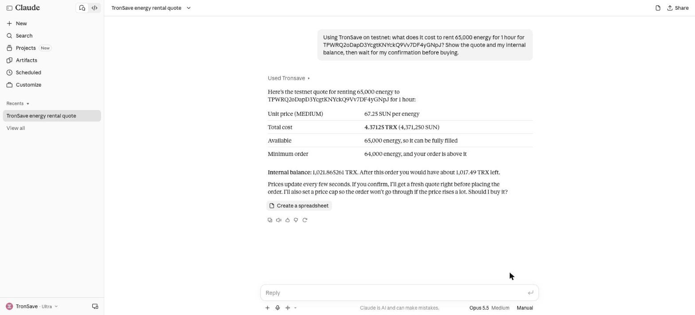
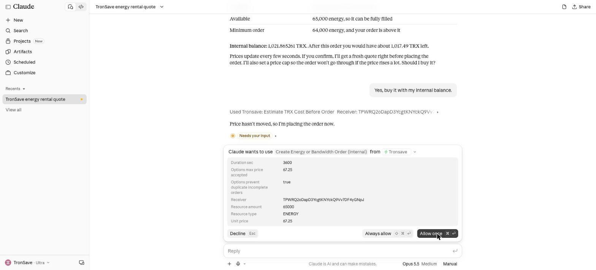
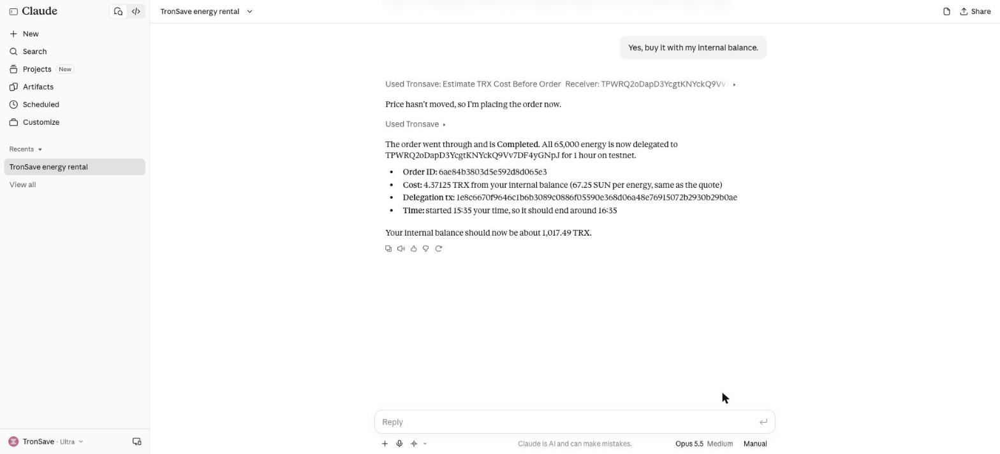

# Use TronSave with AI Assistants

TronSave runs a hosted [MCP](https://modelcontextprotocol.io) server, so AI assistants can work with the TronSave market for you. Ask for the price of energy, get a quote for any wallet, buy ENERGY or BANDWIDTH, and manage your orders and auto-buy rules, all from a chat.

There is nothing to install. You add one URL to your assistant and sign in once.

<figure><figcaption><p>Claude getting a TronSave quote and the internal balance</p></figcaption></figure>

## Pick a URL

<table><thead><tr><th width="330">URL</th><th>Use it when</th></tr></thead><tbody><tr><td><code>https://mcp.tronsave.io/oauth/mcp</code></td><td><strong>Recommended.</strong> Your assistant opens a TronSave sign-in page the first time. Sign in with your API key or your TronLink wallet.</td></tr><tr><td><code>https://mcp.tronsave.io/mcp</code></td><td>Prices and quotes only (no sign-in), or scripts that send an API key in a header.</td></tr><tr><td><code>https://mcp.tronsave.io/oauth/testnet/mcp</code></td><td>Trying it on the <strong>Nile testnet</strong> with test TRX. Nothing real is spent.</td></tr></tbody></table>


Mainnet and testnet are separate. A sign-in on one URL does not work on the other.


## Claude Code

1. Add TronSave once, for all your projects:

   ```bash
   claude mcp add --transport http --scope user tronsave https://mcp.tronsave.io/oauth/mcp
   ```
2. Start Claude Code, type `/mcp`, select **tronsave** and choose **Authenticate**. Your browser opens the TronSave sign-in page. When it confirms, return to the terminal.
3. Ask: *"Use TronSave to show the current price of energy."*

To use an API key instead (servers, CI), add it as a header and keep it out of shared project files:

```bash
claude mcp add --transport http --scope user tronsave https://mcp.tronsave.io/mcp \
  --header "Authorization: ApiKey YOUR_TRONSAVE_API_KEY"
```

## Cursor

Add this to `~/.cursor/mcp.json` (all projects) or `.cursor/mcp.json` (one project):

```json
{
  "mcpServers": {
    "tronsave": {
      "url": "https://mcp.tronsave.io/oauth/mcp"
    }
  }
}
```

Then open **Cursor Settings → MCP**, find **tronsave** and sign in. Cursor opens the TronSave sign-in page in your browser.

You can also paste this one-click install link into your browser's address bar:

```
cursor://anysphere.cursor-deeplink/mcp/install?name=tronsave&config=eyJ1cmwiOiJodHRwczovL21jcC50cm9uc2F2ZS5pby9vYXV0aC9tY3AifQ==
```

## Claude (web and desktop)

1. Go to **Settings → Connectors → Add custom connector**. Custom connectors depend on your Claude plan.
2. Name it `TronSave` and use the URL `https://mcp.tronsave.io/oauth/mcp`. Click **Add**, then **Connect**.
3. Sign in on the TronSave page and start a chat.

Claude asks before it uses each TronSave tool. For anything that buys or changes something, choose **Allow once** after checking the details.

<figure><figcaption><p>Claude shows the order parameters and asks before buying</p></figcaption></figure>

## Signing in

The TronSave sign-in page offers two methods:

<table><thead><tr><th width="190">Sign in with</th><th>What it unlocks</th><th width="150">How long it lasts</th></tr></thead><tbody><tr><td><strong>API key</strong></td><td>Your internal balance: buy from the balance, order history, deposit address. See <a href="../developers/authentication.md#get-an-api-key">Get an API key</a>.</td><td>30 days</td></tr><tr><td><strong>TronLink wallet</strong> (or a signature from any TRON wallet)</td><td>Your wallet account: orders, auto-buy and auto-sell settings, notifications, API keys.</td><td>24 hours</td></tr></tbody></table>


You only sign a short timestamp message. TronSave never asks for your private key or seed phrase. Never paste either into a chat with an AI assistant.


Prices, quotes and market data work without signing in.

## Things to ask

* "What's the cheapest energy on TronSave right now?"
* "How much energy does my wallet need for a USDT transfer, and what would it cost?"
* "Buy 130k energy for one day for my wallet with my TronSave balance."
* "Show my open orders and cancel the oldest one."
* "Keep my wallet above 100k energy with auto-buy, budget 50 TRX."

<figure><figcaption><p>The order is placed and the energy is delegated</p></figcaption></figure>

## Safety

* Every action that spends funds or changes settings is marked as a write, so your assistant asks before running it.
* Orders carry a price cap and duplicate protection, and a failed purchase is never retried automatically.
* Check the plan and the TRX total before you approve. On-chain payments are final.
* New to it? Start with the testnet URL and a Nile wallet.

## Troubleshooting

<table><thead><tr><th width="300">You see</th><th>Do this</th></tr></thead><tbody><tr><td>"Needs authentication" or a <code>401</code></td><td>Sign in again: <code>/mcp</code> → Authenticate in Claude Code, the sign-in button in Cursor, <strong>Connect</strong> in Claude.</td></tr><tr><td><code>SESSION_REQUIRED</code></td><td>That tool needs an account. Use the <code>/oauth/mcp</code> URL and sign in.</td></tr><tr><td><code>INVALID_SESSION_TYPE</code></td><td>That tool needs a wallet sign-in. Reconnect and choose TronLink.</td></tr><tr><td>Wallet tools stop after a day</td><td>Wallet sign-ins last 24 hours. Sign in again.</td></tr><tr><td><code>OAUTH_INVALID_TOKEN</code> about testnet/mainnet</td><td>You signed in on the other network. Use the matching URL.</td></tr></tbody></table>

## Next steps

* [MCP Server reference](../developers/api-reference/mcp.md) — every tool, for developers
* [Connect a wallet](connect-wallet.md) · [Auto Buy](buy/auto-buy.md)
